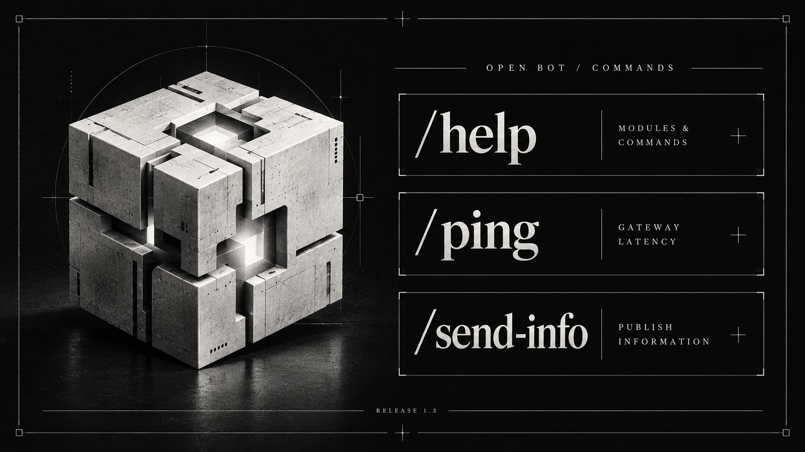
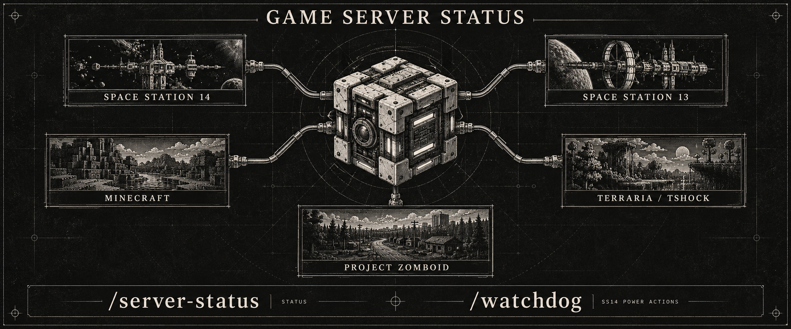

<p align="center">
  
</p>

<p align="center">
  <a href="README.md"><b>English</b></a> · <a href="README_RU.md">Русский</a>
</p>

<p align="center">
  <b>Your Discord server. One control panel.</b><br>
  Rules, tickets, moderation, messages and game monitoring — in modules you choose.
</p>

<p align="center">
  <a href="https://github.com/cryals/open-bot/releases/tag/v1.3.0"></a>
  <a href="https://nodejs.org/en/download"></a>
  <a href="docs/user/catalog.md"></a>
  <a href="docs/DOCKER.md"></a>
  <a href="https://github.com/cryals/open-bot/actions/workflows/check.yml"></a>
  <a href="LICENSE"></a>
</p>

---

**Open Bot** is a self-hosted Discord bot with a web administration panel and modular slash commands. Publish rules and rich messages, handle tickets, manage moderation and monitor game servers. One installation serves one Discord guild; optional modules stay off until configured.

## Start here

| Use Open Bot                                               | Develop Open Bot                                                    |
| ---------------------------------------------------------- | ------------------------------------------------------------------- |
| **[User documentation →](docs/user/README.md)**            | **[Developer documentation →](docs/developer/README.md)**           |
| Installation, permissions, panel walkthroughs and backups. | Architecture, module lifecycle, commands, metrics and contributing. |

[All modules & commands](docs/user/catalog.md) · [Release 1.3 notes](docs/RELEASE-1.3.md)

## Commands, without the guesswork

<p align="center">
  
</p>

`/help` lists the commands available to you. `/ping` reports latency. Administrators use `/send-info` to send the **published** information snapshot. Browse [each module's page](docs/user/catalog.md) for its commands and access requirements.

<p align="center">
  
</p>

`/server-status` supports **SS14, SS13, Minecraft Java/Bedrock, Terraria TShock and Project Zomboid**. `/watchdog` provides confirmed **SS14** power actions. [Server setup and protocol requirements →](docs/user/game-servers.md)

_Command illustrations are artwork. The [user guides](docs/user/README.md) show real panel screenshots._

## Requirements & stack

**Node.js 24.18+**, a Discord bot application, OAuth credentials and a writable data directory. Redis is optional. External feeds require their own provider credentials; Docker requires an available Docker Engine.

**TypeScript · discord.js 14 · Components V2 · Fastify · React · Vite · SQLite / Drizzle · Redis Streams · Prometheus / Grafana · MkDocs Material**

## Run it

```sh
git clone https://github.com/cryals/open-bot.git
cd open-bot
npm ci
cp .env.example .env
```

Fill in `BOT_TOKEN`, `GUILD_ID`, `CLIENT_ID`, `CLIENT_SECRET` and `REDIRECT` in `.env`. On PowerShell use `Copy-Item .env.example .env`. Register the exact callback URL in the Discord Developer Portal, then:

```sh
npm run build
npm start
```

Open [localhost:3000](http://localhost:3000) (or your configured `PORT`), sign in with Discord and configure access and modules in the panel.

**[Full installation guide →](docs/user/setup.md)** · **[Docker / HTTPS →](docs/DOCKER.md)** · **[Development setup →](docs/developer/workflow.md)**

## License & legal

© 2026 cryals and contributors. [Open Bot Project License 1.0](LICENSE) is a **custom source-available license**. Private non-commercial use is allowed; public/community deployment, redistribution and commercial use require prior written permission from cryals.

[Third-party notices](THIRD_PARTY_NOTICES.md) · [Artwork provenance](docs/ARTWORK.md) · Licensing: **support@stopco.ru**.

Open Bot is an independent project, not affiliated with Discord Inc. Discord and game names belong to their respective owners. The project license does not replace third-party license terms. Keep bot tokens and OAuth secrets private.
