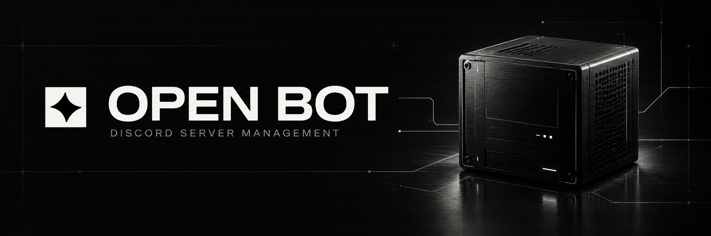
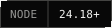
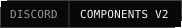
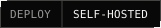
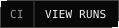
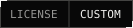
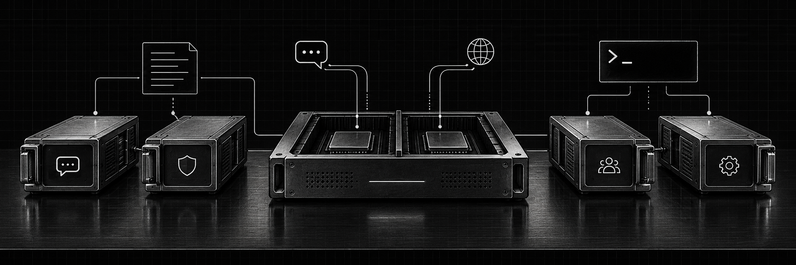

<p align="center">
  
</p>

<p align="center">
  <sub><code>ЯЗЫК</code></sub><br>
  <a href="README.md">English</a> · <b>Русский</b>
</p>

<p align="center">
  <b>Ваш Discord-сервер. Одна панель управления.</b><br>
  Напишите правила. Соберите сообщение. Сохраните историю изменений.
</p>

<p align="center">
  
  <a href="https://nodejs.org/en/download"></a>
  <a href="docs/MODULES.md"></a>
  <a href="docs/OPERATIONS.md"></a>
  <a href="https://github.com/cryals/open-bot/actions/workflows/check.yml"></a>
  <a href="LICENSE"></a>
</p>

<p align="center">
  <a href="#docker">Docker</a> · <a href="#быстрый-запуск">Node.js</a> · <a href="docs/OPERATIONS.md">Развёртывание</a> · <a href="docs/MODULES.md">Модули</a> · <a href="LICENSE">Лицензия</a>
</p>

---

**Open Bot** — бот для управления серверами Discord с веб-панелью, визуальным редактором сообщений и модульными slash-командами. Публикуйте информацию сообщества, ведите правила Discord и игры, добавляйте ссылки на вики и поддержку. Каждый участник листает правила в сообщении, видимом только ему, не переключая страницы другим.

**Релиз 1.0.** [Портал пользователя](docs/user/README.md) · [Портал разработчика](docs/developer/README.md). После установки оба портала доступны по **`/docs/`** на адресе панели: пошаговые инструкции, скриншоты интерфейса и справочники.

Open Bot — название продукта. **Open Space** — название сообщества в начальных текстах правил. Сейчас одна установка обслуживает **один Discord-сервер**.

## Возможности

- **Правила с личной навигацией.** Одно публичное сообщение для входа, логические страницы и вступление, которое остаётся на каждой странице.
- **Визуальный редактор Components V2.** Текст, контейнеры, секции, изображения, галереи, файлы, разделители и кнопки-ссылки. Блоки можно перемещать, дублировать и переносить в контейнеры.
- **Сообщения от имени бота.** Черновики, шаблоны, до десяти сообщений за отправку, настройки уведомлений и редактирование по сохранённым ID.
- **Черновики и история публикаций.** Сохраняйте правки, проверяйте предпросмотр, публикуйте готовую версию или возвращайте старую в черновик.
- **Панель для администрации.** Вход через Discord OAuth, проверка актуальных ролей и настройка доступа.
- **Подробный журнал действий.** Кнопки, изменения полей, значения до и после, построчная разница и операции бота в SQLite и JSONL.
- **Модульный запуск.** Core, Web, Help и Info; отдельные процессы Bot и Web; восстановление рабочих процессов и очередь ошибок с резервным вебхуком.

## Как это работает

1. Откройте панель и войдите через Discord.
2. Выберите канал публикации и роль администратора.
3. Соберите информационное сообщение и отредактируйте страницы правил.
4. Сохраните черновик и опубликуйте готовую версию.
5. Участники нажимают **«Читать правила»** и выбирают правила Discord или игры.

В информационное сообщение можно добавить ссылки на вики, лаунчер, поддержку и документы. Повторная публикация обновляет сообщение по сохранённому ID. Если его удалили, следующая публикация создаст новое и запомнит его ID.

## Docker

Нужны Docker Engine с Compose или Docker Desktop в режиме Linux containers. В клонированном репозитории:

```sh
cp .env.example .env
```

Заполните данные Discord и OAuth callback в `.env`, затем запустите:

```sh
docker compose up -d --build
```

По умолчанию панель доступна на [localhost:3000](http://localhost:3000). SQLite, вложения, логи и резервные копии сохраняются в именованном томе. Устанавливать Node.js на хост не нужно. В PowerShell вместо `cp` используйте `Copy-Item`.

Для публичного домена с автоматическим HTTPS задайте `DOMAIN` и `REDIRECT`, затем:

```sh
docker compose -f compose.yaml -f compose.https.yaml up -d --build
```

Настройка Discord, существующий `.env` в родительской папке, копии, перенос данных и HTTPS описаны в [инструкции Docker](docs/DOCKER.md).

## Быстрый запуск

Нужны **Node.js 24.18+** и приложение Discord с аккаунтом бота.

```sh
git clone https://github.com/cryals/open-bot.git
cd open-bot
npm ci
cp .env.example .env
```

В PowerShell последнюю команду замените на `Copy-Item .env.example .env`. Если репозиторий закрыт, для клонирования нужен доступ к нему.

Заполните `.env`:

```dotenv
BOT_TOKEN=токен_бота
GUILD_ID=id_Discord_сервера
CLIENT_ID=id_приложения
CLIENT_SECRET=секрет_OAuth_приложения
PORT=3000
REDIRECT=http://localhost:3000/auth/discord/callback
```

В [Discord Developer Portal](https://discord.com/developers/applications) добавьте точный адрес `REDIRECT` в **OAuth2 → Redirects**. Установите приложение на сервер со scopes `bot` и `applications.commands`. Выдайте боту права **View Channel**, **Send Messages**, **Read Message History** и **Attach Files** в нужных каналах. Из Gateway intents используется только **Guilds**.

```sh
npm run build
npm start
```

Откройте [localhost:3000](http://localhost:3000), войдите через Discord, выберите канал в **«Настройках»** и опубликуйте первое информационное сообщение. Если в `.env` указан другой `PORT`, используйте его.

Все переменные окружения, доступ, HTTPS и восстановление описаны в [инструкции по эксплуатации](docs/OPERATIONS.md).

## Команды

| Команда                | Модуль | Назначение                                                          |
| ---------------------- | ------ | ------------------------------------------------------------------- |
| `/help [module]`       | Help   | Справка по командам с группировкой по модулям.                      |
| `/ping`                | Core   | Pong, время подтверждения команды, задержка Gateway и время работы. |
| `/info`                | Info   | Личное меню опубликованных правил Discord и игры.                   |
| `/status`              | Core   | Диагностика процессов и модулей для администрации.                  |
| `/send-info [channel]` | Info   | Отправка или обновление опубликованной информации администратором.  |

Команды регистрируются автоматически на сервере из `GUILD_ID`. `/send-info` использует **опубликованный снимок** и не публикует незавершённые правки из веб-панели.

## Модули и восстановление

<p align="center">
  
</p>

Core запускает сервисы. Help собирает справку из реестра команд. Info отвечает за опубликованную информацию и навигацию по правилам. Web обслуживает панель и OAuth в отдельном процессе.

Супервизор следит за рабочими процессами и перезапускает упавший процесс с нарастающей задержкой. Ошибка запуска необязательного модуля изолируется. В production внешний менеджер службы восстанавливает сам супервизор. Порядок запуска, ограничения восстановления и добавление модулей описаны в [документации](docs/MODULES.md).

## Журнал действий и ошибки

**Журнал действий** сохраняет операции администрации и бота, изменения текста и построчную разницу. Полные записи доступны в панели и при экспорте. Для отправки новых событий в Discord выберите канал журнала в **«Настройках»**. Сообщения обычных участников не отслеживаются.

События проходят через Redis Streams и записываются в SQLite пакетами до 100 записей, примерно раз в секунду. Дисковая очередь восстанавливает события после сбоев; без Redis работает тот же пакетный режим. Compose включает Redis автоматически. При обычном запуске задайте `REDIS_URL`, если хотите подключить существующий Redis. [Устройство очереди и восстановление](docs/OPERATIONS.md#пакетный-журнал-и-redis).

**Ошибки** используют отдельные настройки:

```dotenv
LOG_ID=id_канала_ошибок
LOG_WEBHOOK=https://discord.com/api/webhooks/WEBHOOK_ID/WEBHOOK_TOKEN
```

Отчёт сначала записывается на диск. Затем бот отправляет его в канал; если этот путь недоступен, используется независимый вебхук. При сбое обоих способов очередь сохраняется и повторяет попытку позже. В отчёте есть ID ошибки, процесс, область сбоя, stack trace и JSON-вложение. Канал журнала действий и `LOG_ID` настраиваются отдельно.

## Развёртывание и данные

Используйте [Docker Compose](docs/DOCKER.md) или запускайте собранное приложение через `npm start`. Для обычной установки есть [пример systemd-службы](docs/open-bot.service). В Docker предусмотрена дополнительная конфигурация Caddy для HTTPS; при запуске без Docker настройте свой обратный прокси.

```sh
npm run backup
```

Резервная копия содержит SQLite, вложения и журналы действий и ошибок. Восстанавливайте их вместе при остановленном сервисе. Порядок действий — в [инструкции](docs/OPERATIONS.md#резервные-копии-и-восстановление).

```text
src/server/     Discord, OAuth, API, публикации, запуск и модули
src/shared/     Общие схемы, блоки и пагинация
src/web/        Панель управления и визуальный редактор
rules/          Начальные тексты правил Discord и игры
migrations/     Версионированные миграции SQLite
docs/           Эксплуатация, модули и графика README
data/           Локальная база, вложения, логи и копии; исключены из Git
```

## Разработка

```sh
npm run dev
npm run typecheck
npm run format:check
npm run build
```

Для интерфейса Vite задайте в `.env` переменную `APP_ORIGIN=http://localhost:5173`; OAuth callback оставьте на порту бэкенда. Существующие автопроверки запускаются через `npm test`. [Workflow Checks](https://github.com/cryals/open-bot/actions/workflows/check.yml) выполняет форматирование, сборку и тесты при push и pull request. Бейдж CI выше ведёт к реальным запускам.

**Стек:** Node.js 24 · TypeScript · discord.js 14 · Fastify 5 · React 19 · Vite · SQLite · Drizzle ORM.

## Лицензия

[Open Bot Project License 1.0](LICENSE) — собственная лицензия с доступным исходным кодом. Частное некоммерческое использование разрешено. Публичное размещение, использование сообществами, распространение и коммерческое использование требуют предварительного письменного разрешения cryals. Полные условия приведены в `LICENSE` на английском и русском; контакт: `support@stopco.ru`.

Сторонние компоненты сохраняют свои лицензии; см. [уведомления](THIRD_PARTY_NOTICES.md).

<p align="center">
  <sub>Open Bot · автор <a href="https://github.com/cryals">cryals</a> · <a href="docs/ARTWORK.md">Графика и исходники бейджей</a></sub>
</p>
