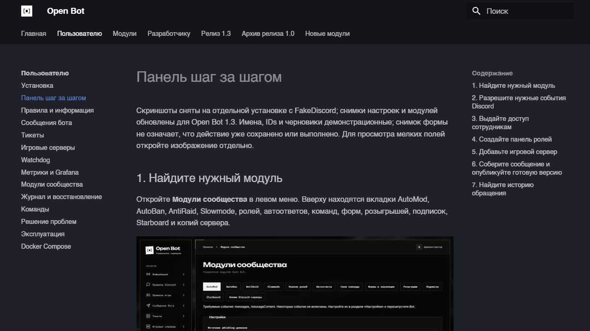

# Разработка и выпуск

## Локальная разработка

Установите зависимости через `npm ci`. Для Vite задайте `APP_ORIGIN=http://localhost:5173`, сохранив OAuth callback на backend-порту с тем же hostname и протоколом. Затем:

```sh
npm run dev
```

Супервизор стартует backend, Vite обслуживает React. `/api` и `/auth` проксируются на backend. После работы верните production origin в окружении. Не запускайте вторую копию поверх работающего supervisor с той же базой.

## Изолированная UI-проверка

```sh
npm run build
npm run ui:harness
```

По умолчанию harness слушает `http://localhost:3311`. Он использует FakeDiscord и in-memory SQLite, не читает настоящий bot token и не публикует на живой сервер. Файл `output/playwright/auth.json` содержит только временную сессию этой копии.

```sh
npx --package @playwright/cli playwright-cli -s=open-bot open http://localhost:3311 --browser chrome
npx --package @playwright/cli playwright-cli -s=open-bot state-load output/playwright/auth.json
npx --package @playwright/cli playwright-cli -s=open-bot reload
npx --package @playwright/cli playwright-cli -s=open-bot snapshot
```

Используйте свежие refs snapshot для click/fill. После перехода переснимайте snapshot. Артефакты сохраняйте в `output/playwright/`; выбранные чистые изображения для руководства копируйте в `docs/assets/screenshots/`. Не публикуйте browser state, трассы с авторизацией или production-переписку.

Для другого свободного порта задайте `UI_PORT` перед запуском harness. Его Origin, callback и cookie остаются локальными. `Ctrl+C` останавливает вашу копию; не завершайте посторонние процессы на занятом порту.

## Проверки

```sh
npm run check
npm run format:check
npm run build
```

`check` запускает TypeScript и тесты FakeDiscord. Интеграционный тест Redis выполняется только при заданном `TEST_REDIS_URL`, иначе помечается skipped. Используйте отдельную тестовую Redis DB; тест создаёт свой UUID-ключ и удаляет его.

```sh
python -m venv .venv-docs
# Активируйте .venv-docs в своей оболочке, затем:
python -m pip install -r requirements-docs.txt
npm run docs:build
npm run docs:dev
```

Вики MkDocs Material собирается отдельно в `site/`, локальный просмотр — `http://127.0.0.1:8000/open-bot/`. Node build не включает документацию, Python не нужен runtime бота. `mkdocs.yml` определяет nav и исключения внутренних specs/отчётов. Workflow Documentation собирает artifact на PR и выполняет Pages deploy после push в main; настройки Pages должны использовать GitHub Actions. Для private repo доступность Pages зависит от плана владельца. Не меняйте visibility или billing ради обхода ограничения. Обычный workflow Checks продолжает собирать и проверять приложение.



При добавлении инструкции включите её в `mkdocs.yml`; изображения храните в `docs/assets/screenshots/` и добавляйте осмысленный alt-текст. Генератор модулей изменяет только свои отмеченные области: пояснения и снимки для конкретного модуля размещайте после `module-reference:end`. Новый [маршрут по панели](../user/visual-guide.md) показывает рекомендуемый формат: точный путь меню, реальный снимок и несколько шагов с объяснением сохранения/публикации.

Иллюстрации шапок справочника хранятся отдельно: `docs/assets/modules/<module-id>.png`. Если изображение существует, `docs:generate` автоматически размещает его под названием модуля. Полные запросы imagegen записаны в `docs/assets/modules/manifest.json`. Это оформление страницы; скриншоты реальной панели остаются в `screenshots/`.

На Windows-машине владельца Docker Engine недоступен из-за виртуализации. Контейнерные сборки и запуски здесь не выполняются. Статическая валидация Compose допустима, а runtime-проверка контейнера выполняется на другом разрешённом хосте. Не включайте Docker/WSL как побочный эффект обычной проверки.

## Выпуск

1. Проверьте, какие возможности действительно присутствуют в коде. Отдельные спецификации не означают готовый модуль.
2. Сделайте резервную копию перед обновлением данных или миграций. Реальная публикация в Discord требует действия администратора.
3. Выполните доступные проверки и запишите ограничения среды, включая пропущенный Redis/Docker.
4. Обновите оба README, порталы, env-пример, AGENTS и навыки при изменении контрактов. Бейдж `Релиз` обозначает состояние продукта, а не успешный CI.
5. Просмотрите весь diff и наличие секретов. Индексируйте конкретные файлы; исключите `.env`, `data/`, `output/`, локальные auth state.
6. Коммит и push выполняйте при авторизации пользователя. После push сравните SHA локального HEAD и remote branch. Проверяйте реальный результат CI; сбой биллинга не является результатом теста.

При обновлении работающей службы остановите её, сохраните данные, обновите зависимости и сборку, затем запустите новую версию. Изменение кода на диске не обновляет уже работающие workers.

## Иллюстрации

Сначала снимайте настоящий интерфейс. Аннотированные версии с рамками/стрелками храните отдельно от исходника и сверяйте с ним. Если imagegen изменил подпись, состояние кнопки или расположение, такая картинка не годится как доказательство поведения — в руководстве должна оставаться исходная и точная текстовая инструкция.

Адрес внешней вики задаётся публичной build-time переменной `VITE_DOCS_URL`, например `https://wiki.example.org/`. Она применяется при сборке React (Compose передаёт её как build arg). Без неё ссылки панели ведут на Markdown в GitHub, чтобы не направлять пользователей на недоступный Pages-хост. Изменение адреса требует пересборки интерфейса; bot token в VITE-переменные не помещают.
