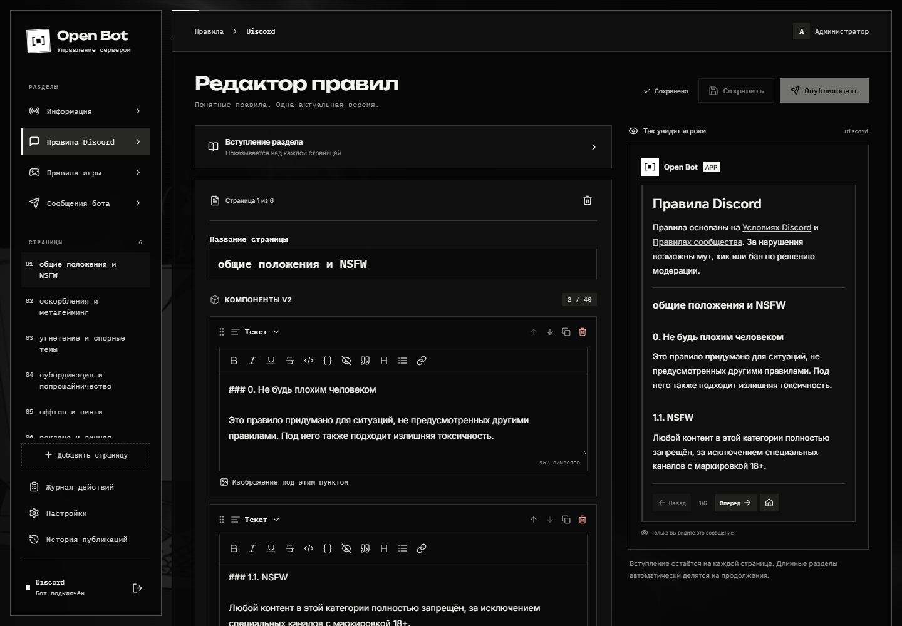

# Руководство пользователя

Open Bot помогает администрации Discord-сервера вести правила и отправлять оформленные сообщения. Участники читают правила в личной панели с кнопками навигации.

## Первый маршрут

**[Панель шаг за шагом: скриншоты и подписи →](visual-guide.md)**

1. [Установите приложение и настройте вход](setup.md).
2. В **Настройках** выберите канал публикации и роль администрации.
3. Соберите [информационное сообщение и страницы правил](rules.md).
4. Сохраните черновик, проверьте предпросмотр и нажмите **Опубликовать**.
5. Для отдельных объявлений используйте [Сообщения бота](messages.md).

## Где что находится

Новые разделы: [Тикеты](tickets.md), [Игровые серверы](game-servers.md), [SS14 Watchdog](watchdog.md) и [Метрики](metrics.md). Роли Ticket видят только разрешённые им обращения и настройки.

| Раздел панели      | Для чего нужен                                                                          |
| ------------------ | --------------------------------------------------------------------------------------- |
| Информация         | Публичная точка входа: описание, кнопка чтения правил, ссылки на вики и другие ресурсы. |
| Правила Discord    | Страницы правил сообщества и их общее вступление.                                       |
| Правила игры       | Отдельный набор страниц игровых правил.                                                 |
| Сообщения бота     | Конструктор объявлений, шаблоны и история отправок.                                     |
| Журнал действий    | Кто и что изменил, значения до и после, ошибки операций.                                |
| Настройки          | Канал публикации, роль доступа, канал журнала, данные сервера.                          |
| История публикаций | Опубликованные версии и возврат выбранной версии в черновик.                            |

**Сохранить** оставляет изменения в черновике. **Опубликовать** делает сохранённую версию доступной участникам. Надпись «Черновик v…» обозначает версию редактируемого содержимого, а не статус разработки продукта.

Далее: [редактирование правил](rules.md) · [все команды](commands.md) · [если что-то не работает](troubleshooting.md).
