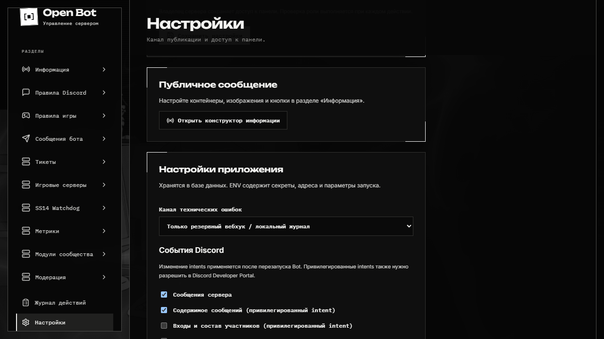
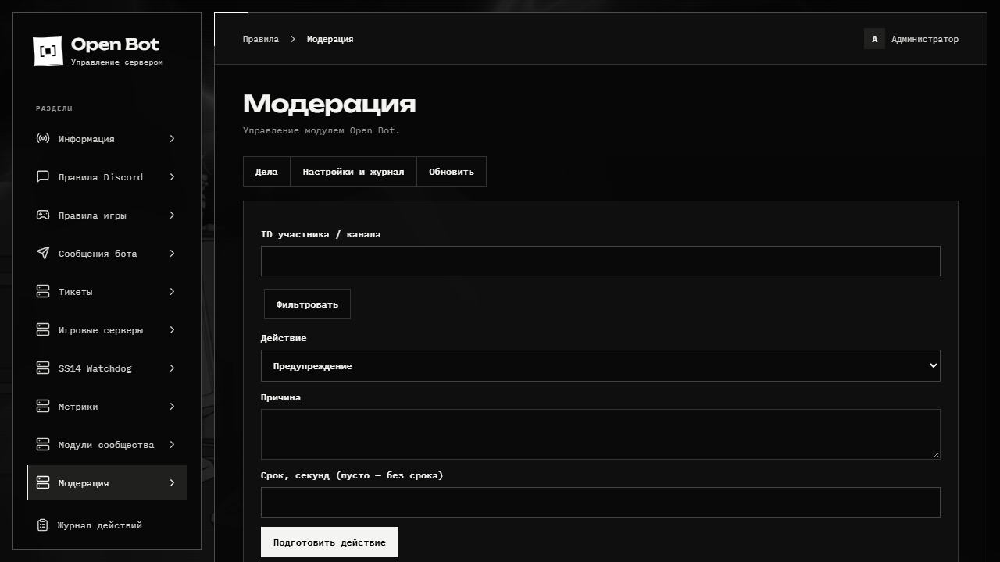
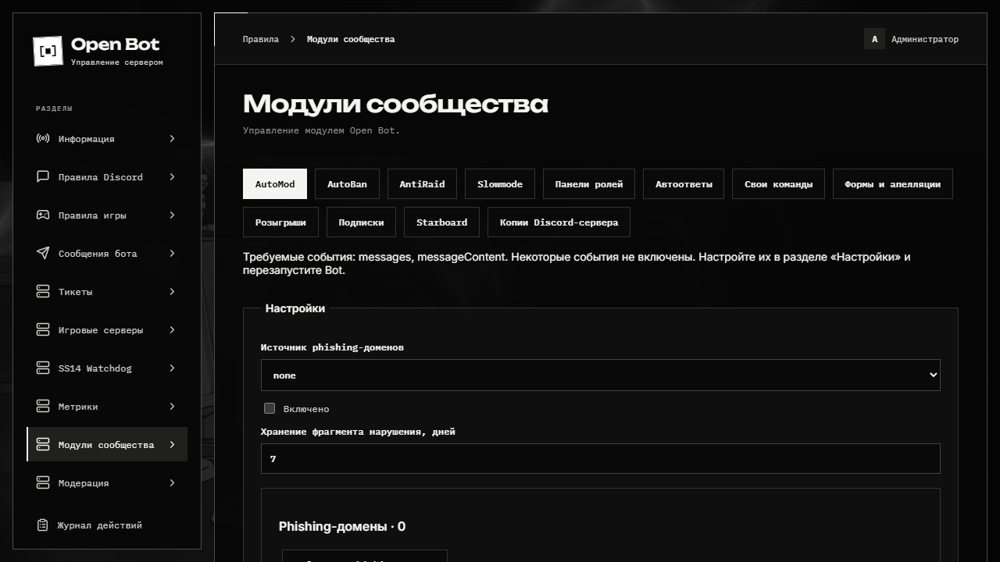

# Модули сообщества

Откройте **Модули сообщества** в боковом меню. Каждый раздел сохраняет собственную конфигурацию с версией. Сохранение из старой вкладки отклоняется, чтобы не затереть чужие изменения.

[Пошаговый маршрут со скриншотами: модули, события, права и панели ролей](visual-guide.md).

## Настройки и доступ



В боковом меню выберите **Настройки**, затем блок **Настройки приложения** ниже формы каналов. Здесь сохраняются события и полномочия; изменение событий вступает в силу после кнопки перезапуска.

**Настройки → Настройки приложения**: события Discord, разрешённые хосты Game Server Status/Watchdog, канал технических ошибок, включение Prometheus и полномочия ролей. Административная роль, канал информации и журнал действий находятся в соседней форме.

В **ENV** остаются токены, ключ шифрования, OAuth, GUILD_ID, адреса/порты слушателей, SQLite/Redis и reverse proxy. Старые `LOG_ID`, `GAME_SERVER_HOSTS`, `WATCHDOG_HOSTS`, `METRICS_ENABLED`, `TICKETS_ENABLED` используются при первом создании конфигурации; после этого источник — SQLite. Изменение ENV не перезаписывает выбор администратора.

Для изменения intents сохраните настройки и нажмите **Перезапустить Bot**. Message Content и Server Members дополнительно разрешаются в Discord Developer Portal. Во время критического задания перезапуск отклоняется.

Полномочия раздельные: чтение/управление модерацией, панели ролей, чтение/управление формами, розыгрыши, подписки и копии сервера. Роли Ticket не получают их автоматически. Администраторы имеют полный доступ; отдельная роль обработки формы видит только соответствующие формы.

## Модерация и журнал



Укажите ID участника/канала, действие и причину. Подготовьте запрос и подтвердите его в течение 90 секунд. Запрос ещё не означает выполненную санкцию.

Доступны warn, закрытые заметки, kick, ban/tempban/softban, timeout, ролевой мут, снятие ограничений, purge и lock/unlock. Timeout ограничен 28 днями. Для ролевого мута задаются роль и снимаемые роли. Purge сохраняет закреплённые сообщения, пока вы явно не разрешите их удаление.

Дело хранит исполнителя, причину, срок, источник, результат и историю. Отмена предупреждения сохраняет исходную запись. Изменение срока — новая подтверждаемая операция, связанная с исходным делом.

Журнал наказаний использует отдельный канал. Карточка показывает **кого / когда / кто / почему / насколько / результат**. Удалённая карточка восстанавливается; сбой доставки не повторяет наказание. Для внешних ban/kick/timeout нужны Guild Moderation и View Audit Log. Обычный выход не считается kick.

`unknown` означает, что Discord мог выполнить действие, но ответ не получен. Сначала сверьте результат, затем укажите «выполнено» или «не выполнено» с причиной. Такое наказание не повторяется автоматически. Временный бан снимается только если текущая причина бана по-прежнему относится к исходному делу.

## Автоматическая защита



Кнопки над формой переключают независимые модули. Добавьте правило, задайте область действия и сохраните. Автоматические меры включайте после выбора действия и необходимых прав.

Новые автоматические действия по умолчанию выключены. Сначала настройте область действия и исключения. AutoMod и AutoBan поддерживают наблюдение без санкций.

| Раздел   | Поведение                                                                                                                                                                     |
| -------- | ----------------------------------------------------------------------------------------------------------------------------------------------------------------------------- |
| AutoMod  | Слова/фразы, домены/инвайты, phishing, частота/дубли, caps, mentions, emoji, вложения, типы файлов, длина, строки, spoilers, Zalgo и специальные каналы. Обрабатывает правки. |
| AutoBan  | Возраст аккаунта, имя и инвайты в имени новых участников. Не запускает ретроактивную чистку.                                                                                  |
| AntiRaid | Порог входов, возраст аккаунта, окно тишины, карантин/санкции, временный lockdown/slowmode. Не отменяет последующие ручные изменения.                                         |
| Slowmode | Нативный интервал Discord либо удаление лишних сообщений ботом. Bot-режим не предотвращает отправку.                                                                          |

Native AutoMod применяется после синхронизации. Поддерживаются слова, инвайты и упоминания; сложные scopes остаются режимом бота. Нужны Manage Server и соответствующие intents. Ошибка синхронизации видна среди заданий.

До успешной синхронизации актуальной конфигурации фильтр обрабатывает бот. Сверка с Discord выполняется раз в минуту: удалённое правило восстанавливается, потерянный ответ создания не приводит к слепому повтору. Для этого резервного режима нужны включённые события сообщений и Message Content.

Native блокирует сообщение до отправки: для `notify`/`review`, сложных исключений и фильтров по окну времени используйте режим бота. Native mentions считает допустимые уникальные упоминания одного сообщения, режим бота — количество в заданном окне и `@everyone`/`@here`. Для поиска подстроки слова обрамляются wildcard; буквальный `*` в Native-слове не поддерживается. [Ограничения Discord Native AutoMod](https://docs.discord.com/developers/resources/auto-moderation).

Phishing-список задаётся вручную или через [SinkingYachts](https://phish.sinking.yachts/docs). Сначала загружается список, затем изменения. При сбое остаётся последняя успешная копия; это не означает запрет всех ссылок. Фрагменты нарушений ограничены 500 символами и удаляются по заданному сроку (1–30 дней).

## Роли, автоответы и свои команды

Панели ролей используют кнопки, меню либо реакции на существующее сообщение. Доступны toggle, выдача/снятие, один/несколько вариантов и случайная роль. После изменения сохраните и опубликуйте панель; старые controls отвергаются по версии.

Публично не выдаются managed-роли, роли выше бота, роли с опасными Discord-правами и роли доступа к Open Bot/Ticket/обработке форм. Меняются только роли выбранной панели; параллельные изменения участника сериализуются.

Автоответы имеют точное совпадение, вхождение и catch-all, приоритеты, scope и cooldown. Удалённое AutoMod сообщение не вызывает ответ. Во время рейда ответы подавляются.

Свои команды содержат аргументы, варианты ответа и разрешённые действия. JavaScript, shell и `eval` не исполняются. Используйте `/custom run` либо отдельное slash-имя. Конфликты системных имён и состояние регистрации видны в модуле. Операции не получают полномочия произвольного администратора.

Переменные текста: `{{user}}`, `{{userId}}`, `{{guild}}`, `{{channel}}`; у автоответов также `{{avatar}}`, у своих команд — `{{arg.имя}}`. У подписок: `{{title}}`, `{{text}}`, `{{url}}`, `{{image}}`, `{{source}}`, `{{game}}`, `{{status}}`. URL-переменная занимает всё поле ссылки и проверяется после подстановки. Неизвестная переменная отклоняется при формировании сообщения. Уведомления и mentions включаются явно.

## Формы и апелляции

Вопросы: короткий/длинный ответ, одиночный/множественный выбор. Discord-форма разбивается на шаги. Длинную форму удобнее открыть по `/forms/ID` на домене панели. OAuth заявителя не открывает административные API.

Для апелляций забаненных включите **Апелляция**, выключите **Только участники** и не требуйте серверную роль заявителя. Номер дела проверяется на принадлежность автору. Принятие заявки само по себе не снимает наказание.

Задайте роли обработки, канал, сроки, cooldown и хранение. При принятии можно выдать безопасную роль или открыть Ticket. Роль чтения не может принимать/отклонять заявки. В анонимном режиме технический ID остаётся в закрытой базе для защиты от спама, но не возвращается обработчикам; связь с делом также скрывается.

## Розыгрыши

Задайте приз, канал, сроки, число победителей и условия. Участие уникально; повторное нажатие может начислить разрешённый ежедневный бонус. `/giveaway enter` принимает необязательного реферера; самореферал исключён.

Перед выбором проверяются актуальные роли участников. Криптографический RNG выбирает без повторов. Результат сохраняется до объявления; повтор доставки не меняет победителей. Reroll исключает прежних победителей и сохраняет причину. Сбой ЛС/наградной роли не отменяет итог.

## Подписки

YouTube, Twitch, Kick, TikTok, Reddit и VK имеют отдельные состояния источников. Один источник опрашивается один раз для всех получателей. Первое подключение не присылает историю; backfill включается явно. Одна публикация не дублируется в одном канале.

OAuth настраивается в подписках. Callback приложения: `/auth/integrations/ПЛАТФОРМА/callback`. API-секреты и `INTEGRATION_KEY` остаются в ENV. Токены зашифрованы AES-256-GCM и не возвращаются в браузер. Ключ сохраняйте с приватными резервными копиями отдельно от Git.

YouTube требует `YOUTUBE_API_KEY`; Shorts идут общим потоком видео: Data API не даёт надёжного признака Shorts произвольного канала. Поиск эфиров имеет интервал и суточный бюджет в панели. Twitch использует EventSub с REST-сверкой, Kick — официальный API. TikTok — только подключённый creator с `video.list`, источник — `open_id`, не произвольный username. Reddit требует разрешённое API-подключение; VK — токен доступа к сообществу. Адаптер не предоставляет scopes и квоты аккаунта.

NSFW исключён по умолчанию, разрешение возможно только в возрастном канале. При `unknown` сначала сверяют ID сообщения, затем разрешают повтор.

## Starboard

Задайте источник, канал, emoji, порог и роли голосующих. Учитываются уникальные допустимые участники; боты и самоголосование включаются отдельно. Счёт восстанавливается из Discord; правки, удаление и падение ниже порога обновляют копию.

Ticket, staff, журналы и сами доски исключены. Требуется совпадение правил видимости каналов. Перенос из возрастного канала в обычный запрещён; приватные ветки не публикуются.

## Копии сервера

Расписание задаётся временем и часовым поясом. Число завершённых копий задаётся параметром **Хранить последних копий** (по умолчанию — три); используемая незавершённым восстановлением временно защищена от ротации. Новая фиксируется атомарно. Manifest показывает полноту, ошибки API и файлы вне квоты. Размер файлов и распаковки ограничен.

Снимок включает доступные guild settings, роли/права/порядок, каналы/ветки, последние сообщения каждого канала/ветки (настраивается от 1 до 100, по умолчанию — 20), вложения и дополнительные ресурсы. Назначения ролей включаются отдельно и требуют Members Intent. Это другой объект, чем `npm run backup`, сохраняющий SQLite и локальные файлы приложения.

По умолчанию восстановление добавляет объекты. Замена требует `REPLACE GUILD_ID` и отдельного подтверждения. Новые каналы создаются закрытыми; права возвращаются с remap. Неопределённый шаг останавливается до сверки ID. Отмена не удаляет уже созданные объекты.

Сообщения отправляет Open Bot с подписью исторического автора:

```text
Привет
-# Автор: <@18474737283> (cryals)
```

Mentions выключены. Старые IDs, автор отправки, даты и чужие реакции не назначаются заново. Managed-роли, интеграции, Lottie и недоступные свойства могут требовать ручного восстановления; ограничения видны в manifest/плане.
