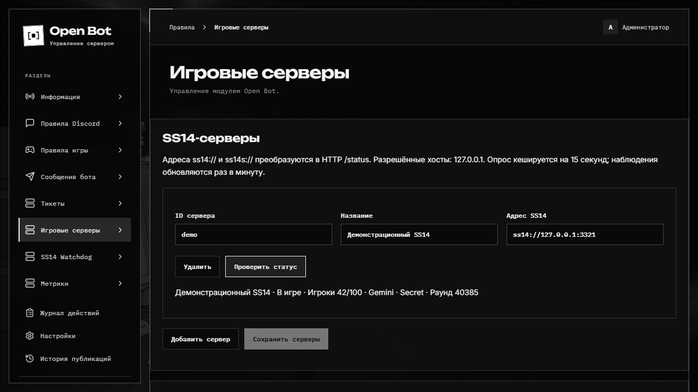

# Игровые серверы SS14

Модуль показывает статус по запросу и обновляет постоянные сообщения Components V2. Основа поведения — [upstream wizard-cogs](https://github.com/space-wizards/wizard-cogs), а не устаревший русскоязычный форк.

## Подключение

1. В **Настройки → Настройки приложения** добавьте точные разрешённые хосты SS14, например `lizard.spacestation14.io` и `ss14.example.org`, без схемы, порта и пути.
2. Сохраните настройки. Список хостов применяется без перезапуска.
3. В **Игровые серверы** добавьте уникальный ID, название и адрес `ss14://host:1212` или `ss14s://host/server`.
4. Сохраните конфигурацию. Нажмите получение статуса или используйте `/server-status server:ID`.
5. Для постоянного сообщения выберите сервер, канал и добавьте наблюдение. Первый результат отправит Bot worker; далее он обновляет сохранённое сообщение раз в минуту.

`ss14://` использует HTTP, порт по умолчанию 1212; `ss14s://` — HTTPS и 443. Путь сохраняется, к нему добавляется `/status`. Адреса с паролем, query или fragment не принимаются. Хосты вне allowlist и HTTP-перенаправления запрещены.

## Отображение и команды

Карточка содержит имя, игроков/мягкий лимит, фазу раунда, длительность текущего раунда, карту, режим, ID раунда и время обновления. Если endpoint недоступен, карточка показывает недоступность. Необязательные поля отмечаются как неизвестные.

| Команда                            | Назначение                                |
| ---------------------------------- | ----------------------------------------- |
| `/server-status [server]`          | Личный ответ со статусом.                 |
| `/server-config list`              | Список настроенных серверов.              |
| `/server-config add` / `remove`    | Настройки серверов, только администрация. |
| `/server-config watch` / `unwatch` | Постоянные сообщения в каналах.           |

Кеш действует 15 секунд, одновременные запросы одного адреса объединяются. Таймаут внешнего запроса — 5 секунд. Сбой одного наблюдения не прекращает остальные. При удалении Discord-сообщения оно создаётся заново; отключение наблюдения убирает его через фоновое задание. Данные серверов и ID сообщений переживают перезапуск.
