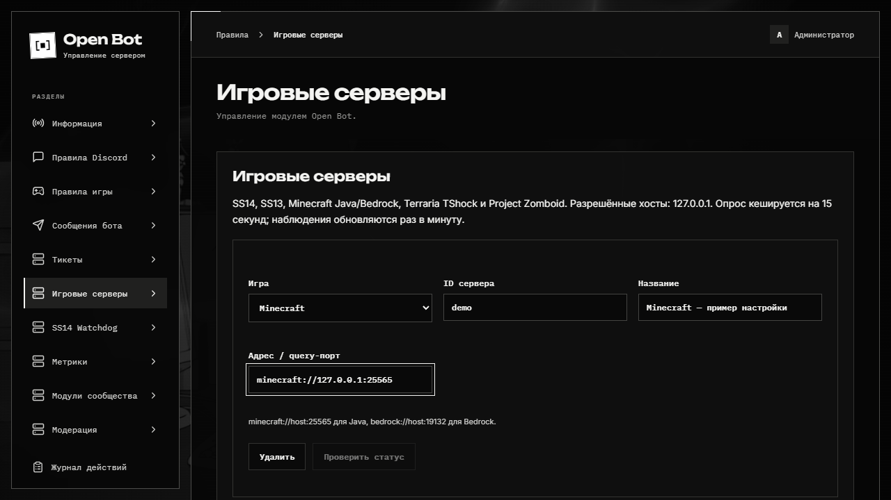

# Игровые серверы

Game Server Status поддерживает Space Station 14, Space Station 13, Minecraft Java/Bedrock, Terraria через TShock и Project Zomboid. Статус доступен в панели, через slash-команду и в обновляемом сообщении Components V2.

## Подключение

1. В **Настройки → Настройки приложения** добавьте точные разрешённые хосты серверов без схемы, порта и пути. Список применяется без перезапуска.
2. Откройте **Игровые серверы**, добавьте сервер и выберите игру.
3. Задайте ID, название и адрес из таблицы. Не помещайте пароль или токен в URL.
4. Сохраните конфигурацию. Нажмите **Проверить статус** либо вызовите `/server-status server:ID`.
5. Для постоянной карточки выберите сервер и Discord-канал в блоке **Обновляемые сообщения**.

| Игра              | Пример адреса                                | Требования                                                                                                                |
| ----------------- | -------------------------------------------- | ------------------------------------------------------------------------------------------------------------------------- |
| Space Station 14  | `ss14s://host/server` или `ss14://host:1212` | HTTP `/status`; путь добавляется автоматически.                                                                           |
| Space Station 13  | `byond://host:1337`                          | Явный игровой порт BYOND, публичный ответ на `?status`. Набор полей зависит от сборки.                                    |
| Minecraft Java    | `minecraft://host:25565`                     | Server List Ping; на сервере должен быть разрешён status.                                                                 |
| Minecraft Bedrock | `bedrock://host:19132`                       | Доступность UDP/RakNet status.                                                                                            |
| Terraria          | `https://host:7878`                          | **TShock REST**, базовый HTTP(S)-адрес. К нему добавляется `/v2/server/status`. Это не обычный игровой порт 7777.         |
| Project Zomboid   | `udp://host:16261`                           | Реальный Steam/A2S query-порт из конфигурации сервера. Он может отличаться от игрового порта; автоопределения портов нет. |

Для Terraria vanilla подробный мониторинг не предоставляется: установите TShock и включите REST. Если endpoint требует токен, сохраните его в `GAME_SERVER_TOKEN_TERRARIA`, перезапустите службу и выберите **имя** переменной в панели. Дополнительные имена `GAME_SERVER_TOKEN_*` явно передаются в Compose override. Значение токена не попадает в конфигурацию панели, карточку или метрики. Используйте HTTPS либо свою защищённую сеть.

## Опрос и карточки

Все настроенные серверы опрашиваются примерно раз в минуту, даже если карточка в Discord не опубликована. Одновременно выполняется до четырёх запросов. Кеш на 15 секунд хранится в SQLite и доступен Bot/Web; одновременные запросы внутри процесса объединяются. Изменение адреса или игры делает прежнюю запись неактуальной.

Таймаут протокола — 5 секунд. Используется только указанный query-порт без перебора соседних портов. HTTP-перенаправления, credentials, query и fragment в настраиваемом адресе запрещены. Для TShock служебный token-параметр добавляется только сервером.

Карточка показывает игру, доступность, онлайн/лимит, карту или мир, версию и время query, если протокол возвращает эти данные. Для SS13/SS14 также доступны режим и сведения о раунде. Неизвестное поле не заменяется нулём. Сбой одного сервера не останавливает другие; удалённая карточка создаётся заново.

## Команды

| Команда                            | Назначение                                                                                                      |
| ---------------------------------- | --------------------------------------------------------------------------------------------------------------- |
| `/server-status [server]`          | Личный ответ со статусом или список серверов.                                                                   |
| `/server-config list`              | Список серверов и карточек.                                                                                     |
| `/server-config add`               | Добавить ID, название, адрес, `game` и необязательный `token-env`; без `game` сохраняется совместимость с SS14. |
| `/server-config remove`            | Удалить сервер.                                                                                                 |
| `/server-config watch` / `unwatch` | Включить или убрать постоянную карточку.                                                                        |

Настройки требуют административного доступа. Публичный `/server-status` не изменяет настройки и не раскрывает адрес или токен.

## Grafana

Метрики доступны по игре без ID серверов, адресов и имён игроков в labels. Данные старше 150 секунд, ещё не опрошенные или относящиеся к старой конфигурации помечаются `unknown`. Число игроков суммируется только по свежим доступным ответам; `open_bot_game_player_samples` показывает количество серверов с известным онлайном.

[Метрики и dashboard](metrics.md) · [Автоматический справочник команд](modules/game-server-status.md).

## Протоколы

[GameDig: протоколы и ограничения](https://github.com/gamedig/node-gamedig/blob/master/GAMES_LIST.md), [TShock REST status](https://tshock.readme.io/reference/v2status). Доступность query определяется настройками конкретного сервера и его firewall.
