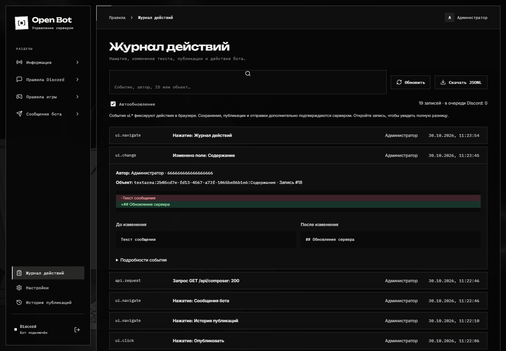
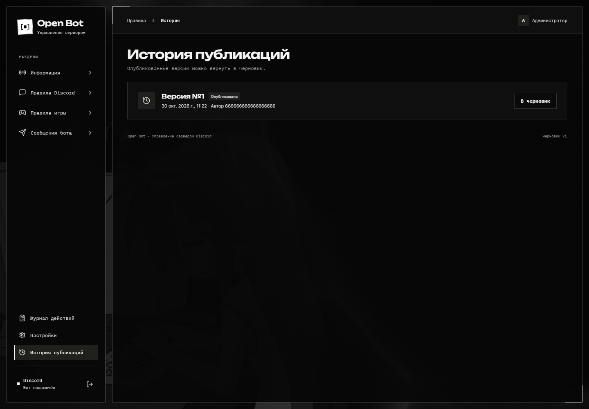

# Журнал и восстановление

## Журнал действий



Откройте **Журнал действий**. Поиск помогает найти операции по тексту, типу и объекту. Раскройте запись, чтобы увидеть подробности, старое и новое значения, построчную разницу.

Журнал включает действия администрации в панели, команды и кнопки бота, сохранения и публикации. Наблюдения браузера помечены отдельно от подтверждённых сервером операций. Обычная переписка участников Discord не собирается.

События пишутся пачками: новая запись обычно появляется примерно через секунду, а при накопленной очереди — позже. Отсутствие мгновенной строки не означает, что нужно снова нажимать публикацию. Полный журнал можно выгрузить в JSONL.

Чтобы доставлять новые записи в Discord, выберите **Канал журнала** в настройках. Это отдельный канал от канала ошибок `LOG_ID`.

## Верните прежнюю публикацию



1. Откройте **История публикаций**.
2. Найдите нужную версию по времени и автору.
3. Нажмите **В черновик** и подтвердите замену текущего черновика.
4. Проверьте восстановленный текст и нажмите **Опубликовать**.

Возврат в черновик не меняет Discord до публикации. Несохранённые правки текущего черновика при подтверждённой замене теряются.

## Отчёты об ошибках

`LOG_ID` и `LOG_WEBHOOK` задаются владельцем установки в окружении. При ошибке приложение сохраняет подробный отчёт с ID. Сначала доставка идёт через канал бота, а при неудаче — через резервный вебхук. При недоступности обоих транспортов запись остаётся в дисковой очереди.

Передайте разработчику ID ошибки и время события. Для передачи полного отчёта используйте закрытый канал поддержки: журнал может содержать административные тексты.

## Резервные копии

```sh
npm run backup
```

Копия попадает в `data/backups/`. Она включает SQLite, вложения и существующие очереди и журналы. Для согласованного снимка всех файлов остановите службу перед копированием.

Восстанавливайте базу, вложения и очередь из одной копии при остановленных процессах. Полный порядок и особенности Redis описаны в [справочнике эксплуатации](../OPERATIONS.md#резервные-копии-и-восстановление).
