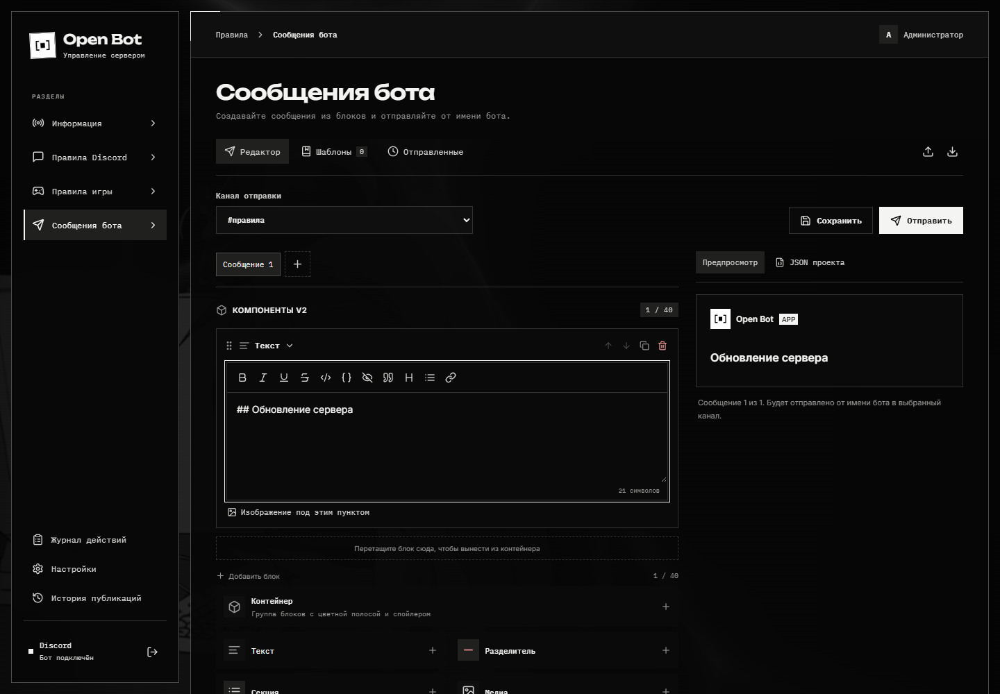

# Сообщения от имени бота

Откройте **Сообщения бота**. Это отдельный конструктор объявлений: его черновик сохраняется независимо от правил и информационного сообщения.

## Создайте сообщение

1. Выберите сообщение в наборе или добавьте новое. За одну отправку допускается до десяти сообщений.
2. Добавьте блоки из палитры. Для начала достаточно **Текст**, **Медиа** и **Ряд кнопок**.
3. Исправьте содержимое, проверьте предпросмотр справа. Вкладка **JSON** помогает посмотреть структуру.
4. Выберите канал назначения.
5. Проверьте настройки упоминаний и тихого уведомления.
6. Нажмите кнопку отправки и подтвердите её в диалоге.

**Сохранить** сохраняет черновик редактора. Сохранение шаблона создаёт заготовку для будущих сообщений. Ни одно из этих действий само по себе ничего не отправляет в Discord.

## Какие блоки доступны

| Блок        | Использование                                                      |
| ----------- | ------------------------------------------------------------------ |
| Текст       | Markdown, заголовки, списки, ссылки и пояснения.                   |
| Контейнер   | Группа блоков с общей рамкой, акцентом и необязательным спойлером. |
| Разделитель | Линия или свободное место между частями.                           |
| Секция      | Текст с миниатюрой или кнопкой справа.                             |
| Медиа       | Галерея изображений.                                               |
| Ряд кнопок  | Ссылки; встроенное действие чтения правил.                         |
| Файл        | Вложение, отправляемое вместе с сообщением.                        |

Изображение можно загрузить или указать ссылкой. Локальные загрузки хранятся вместе с базой и отправляются в Discord как вложения. Нельзя удалять `uploads/`, если эти материалы ещё используются.

## Исправьте уже отправленное сообщение

Перейдите в **Историю** внутри конструктора, выберите отправленное сообщение и откройте редактирование. После правки подтвердите обновление: бот изменит сообщение по сохранённым ID канала и сообщения.

История редактора содержит сообщения, отправленные этим приложением. Для чужих сообщений или сообщений другого бота этот механизм не предназначен. Если сообщение удалено в Discord, отправьте новое.

Если другой администратор успел обновить тот же текст, приложение сообщит о конфликте версии. Загрузите актуальную запись перед новой попыткой.

## Лимиты и частичная отправка

Приложение проверяет Components V2 и размер данных до отправки. В сообщении допускается до 40 компонентов с учётом вложенности; действуют и дополнительные ограничения блока, текста и файлов. Сообщение с ошибкой нужно уменьшить или разделить.

При прерывании многочастной отправки не создавайте сразу новую копию набора: повтор той же попытки может продолжить незавершённую отправку. Дедупликация Discord имеет ограниченное окно; после долгого сбоя сначала проверьте канал и историю, чтобы не продублировать уже доставленное.
