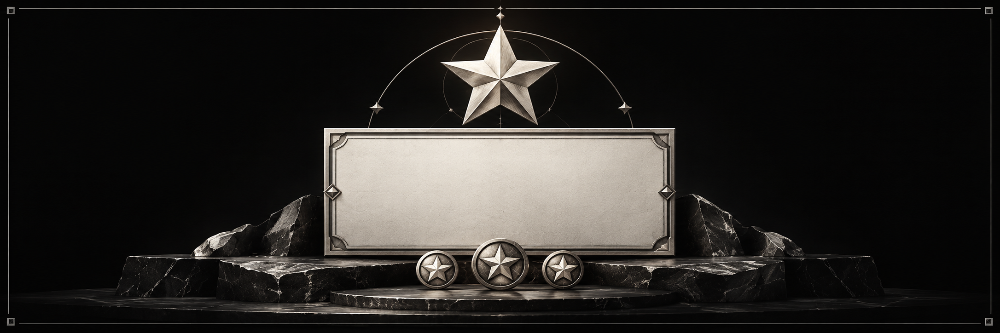

<!-- module-reference:start -->

# Starboard

Подборки сообщений по уникальным голосам с защитой приватных каналов.

**ID:** `starboard` · **Процесс:** Bot.

**Зависимости:** `community`.

**События Gateway:** `messages`, `messageContent`, `reactions`.

**Права бота:** `ReadMessageHistory`, `SendMessages`.

## Команды

| Команда              | Назначение                     | Доступ                   |
| -------------------- | ------------------------------ | ------------------------ |
| `/starboard status`  | Состояние модуля               | Проверяется обработчиком |
| `/starboard enable`  | Включить модуль                | Проверяется обработчиком |
| `/starboard disable` | Выключить модуль               | Проверяется обработчиком |
| `/starboard hide`    | Скрыть публикацию              | Проверяется обработчиком |
| `/starboard message` | Публикации сообщения на досках | Проверяется обработчиком |

Доступ проверяется по актуальным ролям и правам Discord. У отдельных подкоманд могут быть дополнительные ограничения; справочник не выдаёт полномочий.

[Все модули](../catalog.md) · [Настройка модулей](../community.md)

<!-- module-reference:end -->
