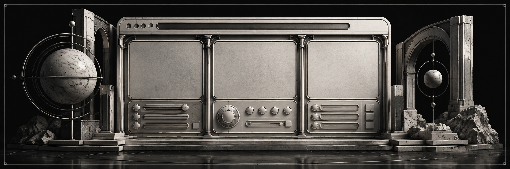

<!-- module-reference:start -->

# Web

Веб-панель управления информацией, правилами, модулями и сообщениями.

**ID:** `web` · **Процесс:** Web.

## Команды

Slash-команд нет. Модуль обслуживает веб-панель в отдельном процессе.

[Все модули](../catalog.md) · [Настройка модулей](../community.md)

<!-- module-reference:end -->
