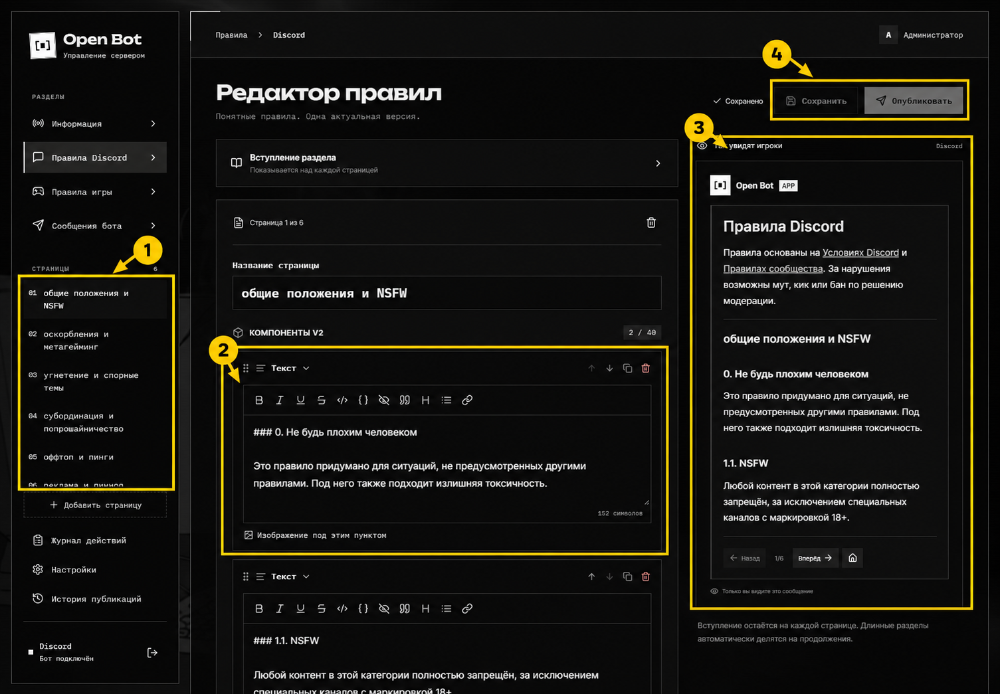

# Правила и информационное сообщение

## Как устроена публикация

У приложения есть общий черновик с информационным сообщением и двумя наборами правил. У каждого набора — вступление и упорядоченные страницы. После публикации участник нажимает **Читать правила**, выбирает Discord или игру и листает страницы в сообщении, видимом только ему.

Вступление выбранного набора остаётся над каждой страницей. Один длинный раздел может автоматически разбиться на продолжения, чтобы уложиться в лимиты Discord.

## Отредактируйте страницу

На иллюстрации: **1** — выбор страницы, **2** — текстовый блок, **3** — предпросмотр, **4** — сохранение и публикация. Это аннотированная версия; [чистый скриншот](../assets/screenshots/rules.png) сохранён отдельно.

1. Выберите **Правила Discord** или **Правила игры** слева.
2. Нажмите нужную страницу под заголовком **СТРАНИЦЫ**. Стрелки рядом меняют её порядок.
3. Исправьте название страницы и текстовые блоки. Панель форматирования вставляет Markdown.
4. Кнопка **Изображение под этим пунктом** добавляет иллюстрацию непосредственно после соответствующего текста. Можно также добавить блок **Медиа**.
5. Посмотрите результат справа и переключите страницы предпросмотра.
6. Нажмите **Сохранить**, затем **Опубликовать** и подтвердите публикацию.

**Добавить страницу** создаёт новый логический раздел. Флажок **Показывать страницу** исключает страницу из следующей публикации, сохраняя её в черновике. Вступление редактируется в раскрываемой области над содержимым страницы.

Если кнопка публикации недоступна, сначала сохраните изменения и выберите канал в настройках. Сообщения об ошибках лимитов нужно исправить до публикации.

## Соберите блок «Информация»

В разделе **Информация** редактируется постоянное публичное сообщение. Можно добавить несколько контейнеров: например, «Правила», «Полезные ссылки», «Поддержка».

1. Добавьте **Контейнер** для группы содержимого.
2. Внутри добавьте **Текст** с заголовком и пояснениями.
3. Добавьте **Ряд кнопок**, создайте ссылку и укажите её название и HTTPS-адрес вики, лаунчера или сайта.
4. Сохраните встроенную кнопку **Читать правила** там, где участникам удобно её найти.
5. Сохраните общий черновик и опубликуйте.

Контейнеры нельзя вкладывать друг в друга. Блоки можно перемещать, дублировать, сворачивать и удалять. Счётчик компонентов помогает контролировать размер.

Повторная публикация обновляет сохранённое сообщение. Если его удалили в Discord, следующая публикация создаст замену и запомнит новый ID.

## Совместное редактирование

Если другой администратор уже сохранил новую версию, сервер отклонит устаревшее сохранение. Скопируйте свои несохранённые изменения, перезагрузите страницу и перенесите их в актуальный черновик. Не отправляйте один и тот же запрос многократно.

Для отката используйте [Историю публикаций](logs.md): возврат версии сначала меняет черновик, после чего требуется отдельная публикация.
