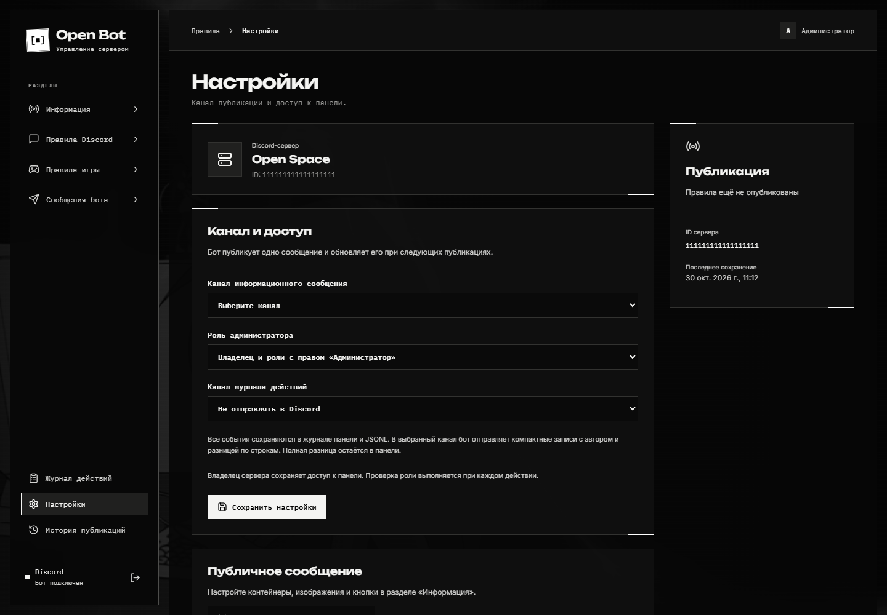

# Установка и первый вход

Рабочие настройки модулей изменяются в [панели](community.md#настройки-и-доступ). ENV содержит технические параметры и секреты; прежние флаги используются только при первом переносе конфигурации.

## Подготовьте Discord-приложение

В [Discord Developer Portal](https://discord.com/developers/applications) создайте приложение и аккаунт бота. Сохраните его Application ID, OAuth Client Secret и Bot Token в своём секретном хранилище.

1. Установите приложение на свой сервер со scopes `bot` и `applications.commands`.
2. Дайте боту **View Channel**, **Send Messages**, **Read Message History**, **Attach Files** в используемых каналах.
3. В **OAuth2 → Redirects** добавьте точный callback, например `http://localhost:3000/auth/discord/callback`.
4. Базовые функции используют intent **Guilds**. Для [Ticket](tickets.md) включите Message Content Intent в Developer Portal и события сообщений в настройках приложения. Новые модули требуют дополнительных событий, указанных в панели.

## Запуск через Node.js

Нужен Node.js **24.18 или новее**, доступ к репозиторию и исходящий доступ к Discord.

```sh
git clone https://github.com/cryals/open-bot.git
cd open-bot
npm ci
```

Скопируйте `.env.example` в `.env` (`Copy-Item .env.example .env` в PowerShell) и заполните:

```dotenv
BOT_TOKEN=ваш_токен
GUILD_ID=id_сервера
CLIENT_ID=id_приложения
CLIENT_SECRET=секрет_OAuth
PORT=3000
REDIRECT=http://localhost:3000/auth/discord/callback
```

```sh
npm run build
npm start
```

Откройте `http://localhost:3000` и нажмите **Войти через Discord**. При другом `PORT` используйте свой порт и такой же callback в Developer Portal. `.env` также можно держать в родительской папке; файл проекта имеет приоритет.

Для установки на сервер с рабочим Docker Engine есть отдельная [инструкция Compose](../DOCKER.md). На машине с недоступной виртуализацией используйте запуск Node.js; Docker для него не нужен.

## Настройте доступ и канал

Откройте **Настройки** в левом меню.



1. **Канал публикации** — куда бот поставит публичное информационное сообщение.
2. **Роль администратора** — кто может управлять панелью. Владелец сервера сохраняет доступ; при пустой роли допускается право Discord Administrator.
3. **Канал журнала** — необязательная доставка административных действий в Discord.
4. Нажмите кнопку сохранения настроек. Само сохранение настроек сообщение не публикует.

`ADMIN_ROLE_ID` задаёт начальную роль только при создании базы. Для существующей установки меняйте роль через панель. При выборе другой роли сервер проверит, что вы не теряете доступ.

Название и значок Discord-сервера подгружаются по `GUILD_ID`; менять название продукта в коде не требуется.

Для публичного доступа настройте HTTPS и точный внешний `REDIRECT`. Все параметры, резервные копии и reverse proxy описаны в [справочнике эксплуатации](../OPERATIONS.md).
