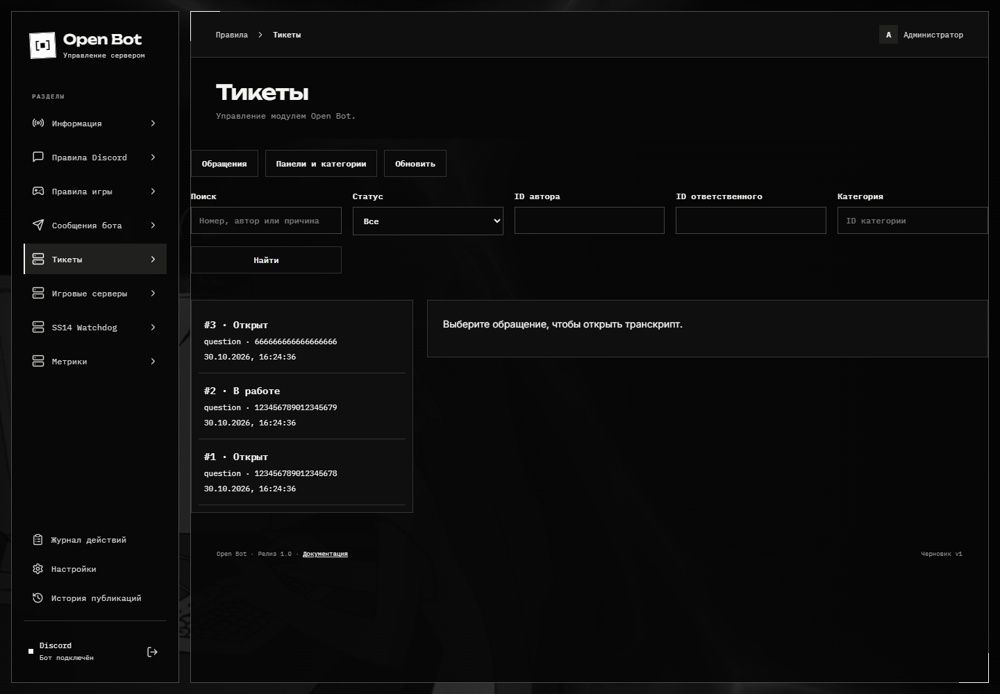
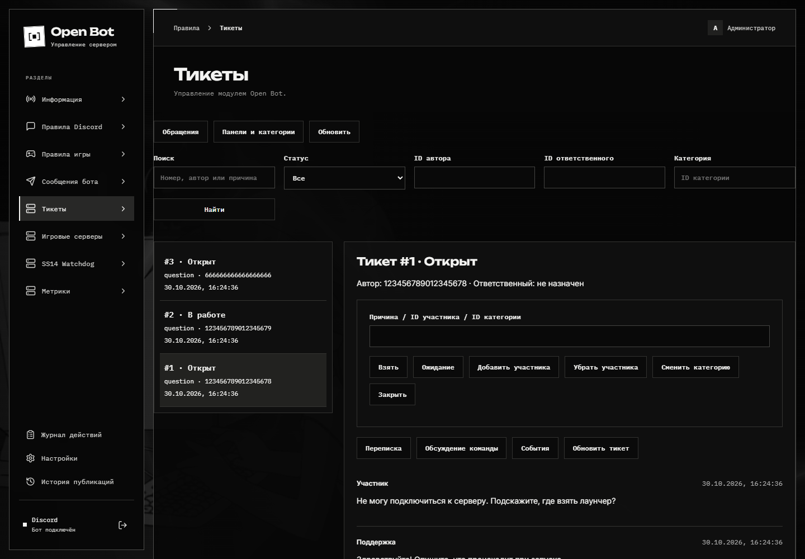

# Тикеты

Ticket создаёт закрытый текстовый канал для обращения и отдельную приватную ветку для обсуждения сотрудниками. Веб-архив хранит переписку, известные правки и удаления, вложения и события обращения.

## Подготовка

1. В Discord Developer Portal включите **Bot → Privileged Gateway Intents → Message Content Intent**.
2. В **Настройки → Настройки приложения** включите события сообщений и Message Content, сохраните и нажмите **Перезапустить Bot**.
3. Дайте боту View Channel, Read Message History, Send Messages, Attach Files, Manage Channels, Create Private Threads, Send Messages in Threads и Manage Threads. Права нужны в соответствующих категориях и служебном канале.
4. Создайте отдельный текстовый служебный канал. Для `@everyone` запретите **View Channel**, двум ролям Ticket разрешите его. Не открывайте канал другим ролям и участникам; доступ бота оставьте.
5. У ролей Ticket уберите **Administrator** и **Manage Threads**. Владельца сервера и пользователей с Administrator Discord технически нельзя скрыть от приватных каналов; не выдавайте эти права обычным пользователям.

## Доступ к панели

| Настраиваемая роль     | Возможности                                                                                       |
| ---------------------- | ------------------------------------------------------------------------------------------------- |
| **Полная роль Ticket** | Панели, категории, сообщения, роли доступа, список обращений, транскрипты и служебные обсуждения. |
| **Роль просмотра**     | Только список и веб-просмотр транскриптов; доступ к служебной ветке через кнопку Discord.         |
| Администратор Open Bot | Полный доступ.                                                                                    |

На новой установке роли не выбраны: администратор задаёт их в панели. Обновление существующей базы сохраняет прежний доступ.

Автор обращения не получает служебный транскрипт и доступ к служебной ветке через Open Bot даже при наличии роли просмотра. Получение роли Ticket не открывает остальные разделы веб-панели. Роли проверяются заново на сервере при запросах.

## Настройка панели

Откройте **Тикеты → Панели и категории**. Выберите служебный канал, роли полного доступа и просмотра. Категории содержат название, описание, эмодзи, Discord-категорию, роли поддержки, необязательную роль уведомления и форму до пяти вопросов. Для имени канала доступны `{id}` и `{user}`. Имя служебной ветки задаётся отдельно и обязательно содержит `{id}`; его нельзя менять при активных обращениях.

Первое сообщение и публичная панель редактируются существующим конструктором Components V2. Сохраните конфигурацию, включите приём обращений, выберите канал и нажмите публикацию. ID панели сохраняется: повторная публикация обновляет её.

Discord-категорию, роли поддержки и полную роль нельзя менять при наличии затронутых активных обращений. Завершите эти обращения, затем меняйте доступ. Выключение приёма не отменяет очистку уже закрытых архивов.

## Работа с обращением

- Участник нажимает **Создать тикет** или вводит `/ticket open`, выбирает категорию и заполняет форму.
- Повторное создание в той же категории возвращает активное обращение. Лимит активных обращений на автора задаётся в настройках Ticket (по умолчанию — три).
- Поддержка берёт обращение, переводит в ожидание, добавляет/убирает участников или меняет категорию. Изменения доступа выполняются сохраняемыми заданиями; результат и ошибки видны в карточке.
- **Служебное обсуждение** добавляет допущенного сотрудника в приватную ветку. Автору тикета эта операция запрещена.
- Закрыть обращение может автор, поддержка категории или администратор. Нужны причина и подтверждение. Канал замораживается; после сохранения доступной истории и копирования вложений удаляется. Служебная ветка архивируется и блокируется.

Выберите обращение в списке. В карточке доступны переписка, обсуждение команды и события; список фильтруется по состоянию, категории, автору и сотруднику. Для старых сообщений есть отдельная загрузка.

## Архив и сбои

Закрытый архив, локальные вложения и служебная ветка удаляются по сроку **Хранение закрытых тикетов** (по умолчанию — 180 дней). Новый срок применяется к последующим закрытиям; уже назначенные даты удаления не меняются. После истечения срока API сразу запрещает чтение; очистка Discord и файлов повторяется при доступности сервиса. Суммарная статистика остаётся обезличенной. Независимые резервные копии имеют собственный срок хранения.

Если вложение не удалось скопировать или превышен лимит архива, канал не удаляется: обращение остаётся в архивировании с причиной ошибки. По умолчанию доступны 25 МБ на вложение и 10 000 МБ на архив; параметры меняются в настройках.

Во время остановки бота нельзя получить события, которые Discord уже не отдаёт. После запуска оставшиеся сообщения сверяются с Discord, а возможный пробел явно отмечается. Это не обещание восстановить сообщения, удалённые до их получения ботом. Скопированные файлы не зависят от срока жизни исходных CDN-ссылок.
