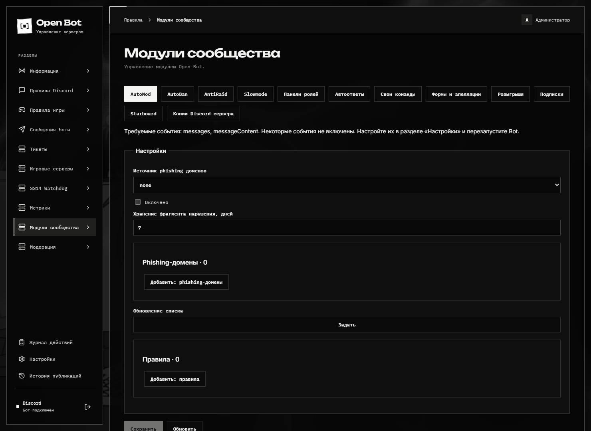
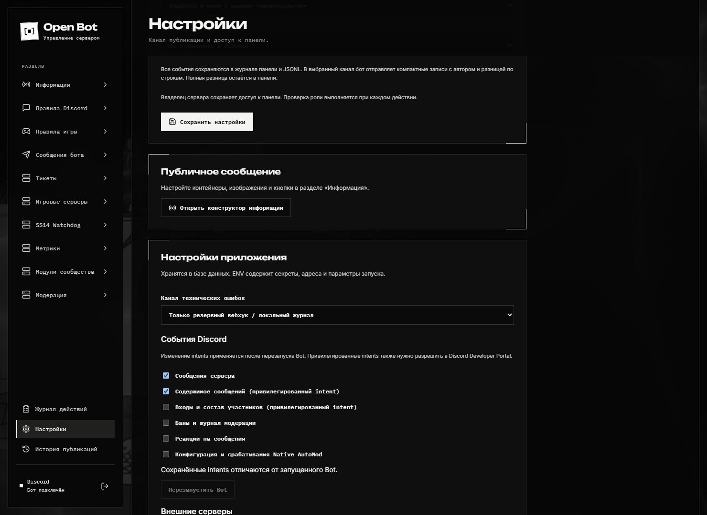
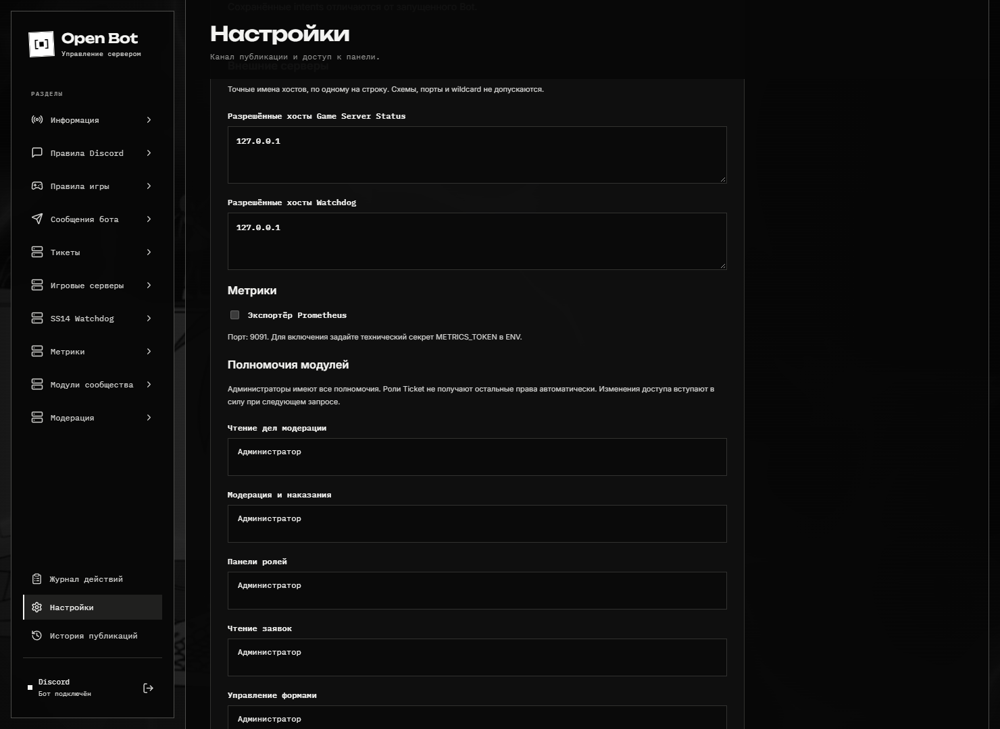
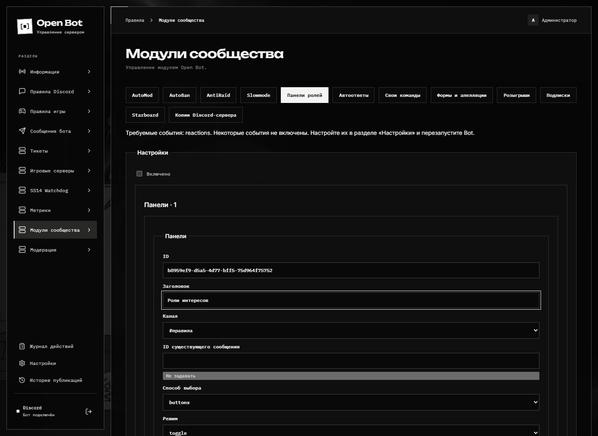
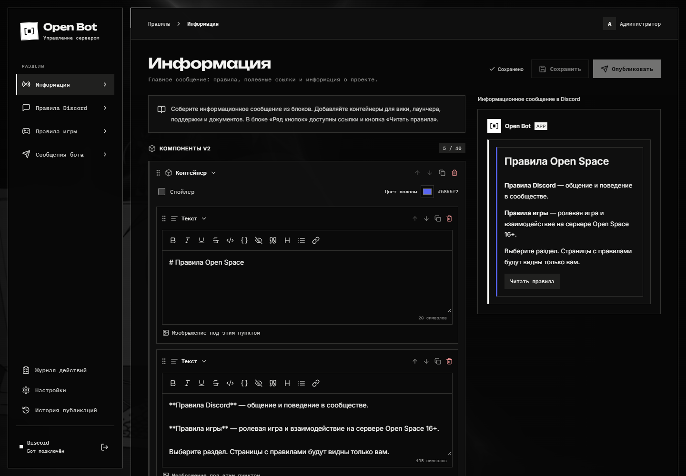

# Панель шаг за шагом

Скриншоты сняты на отдельной установке с FakeDiscord; снимки настроек и модулей обновлены для Open Bot 1.3. Имена, IDs и черновики демонстрационные; снимок формы не означает, что действие уже сохранено или выполнено. Для просмотра мелких полей откройте изображение отдельно.

## 1. Найдите нужный модуль

Откройте **Модули сообщества** в левом меню. Вверху находятся вкладки AutoMod, AutoBan, AntiRaid, Slowmode, ролей, автоответов, команд, форм, розыгрышей, подписок, Starboard и копий сервера.

1. Выберите вкладку, например **AutoMod**.
2. Прочитайте строку **Требуемые события**. При нехватке событий сначала перейдите в настройки из следующего шага.
3. Кнопка **Добавить: правила** создаёт правило. Задайте фильтр, область действия и результат; сначала используйте наблюдение.
4. Включите модуль и нажмите **Сохранить** ниже формы. Состояние операций и ошибки находятся под конфигурацией.

Включение AutoMod может приводить к удалению сообщений и санкциям — проверьте выбранные действия до сохранения. [Подробности модулей сообщества](community.md).

## 2. Разрешите нужные события Discord

Маршрут: **Настройки → Настройки приложения → События Discord**.

1. Включите только необходимые события: например, **Реакции на сообщения** для реакционных панелей или **Конфигурация и срабатывания Native AutoMod** для Native.
2. Для привилегированных событий дополнительно включите соответствующий intent в Discord Developer Portal.
3. Нажмите **Сохранить настройки приложения** внизу формы.
4. Нажмите **Перезапустить Bot**. Само сохранение не меняет уже открытое Gateway-подключение.

На демонстрационном снимке перезапуск недоступен: FakeDiscord не запускает настоящий Bot worker. В рабочей установке интерфейс также сообщает, почему перезапуск временно запрещён. [Установка и intents](setup.md).

## 3. Выдайте доступ сотрудникам

В тех же настройках прокрутите до **Полномочия модулей**.

Выберите роли в нужных списках и сохраните настройки приложения. Чтение дел и применение наказаний — разные полномочия. Аналогично разделены чтение заявок и управление формами. Остальные списки продолжаются ниже снимка.

Администраторы имеют полный доступ. Ticket-роли сами по себе не открывают остальные модули. Разрешение панели не заменяет фактические Discord-права и иерархию ролей.

## 4. Создайте панель ролей

Маршрут: **Модули сообщества → Панели ролей → Добавить: панели**.

1. Задайте понятный **Заголовок** и **Канал**. Сгенерированный ID связывает настройки с панелью; не меняйте его у уже опубликованной панели.
2. В **Способе выбора** укажите `buttons`, `select` или `reactions`. В **Режиме** выберите, например, `toggle` для выдачи и снятия одной кнопкой.
3. Ниже находятся ограничения ролей, конструктор сообщения и **Добавить: варианты панели**. Для каждого варианта задайте подпись и безопасную роль.
4. Включите модуль, сохраните конфигурацию, затем нажмите **Опубликовать**. На снимке показан ещё не сохранённый черновик.

Бот не выдаёт через публичную панель административные и другие опасные роли, включая роли доступа к Open Bot. [Команды и описание панелей ролей](modules/role-menus.md).

## 5. Добавьте игровой сервер

Сначала разрешите точный hostname в **Настройки → Настройки приложения → Внешние серверы**. Затем откройте **Игровые серверы**.

Выберите игру, заполните ID, название и адрес, затем сохраните конфигурацию. **Проверить статус** запрашивает данные сервера; постоянная карточка настраивается отдельно. Для TShock выберите имя ENV-переменной токена, не сам токен.

[Таблица адресов и портов всех пяти игр](game-servers.md) · [SS14 Watchdog и подтверждение действий](watchdog.md).

## 6. Соберите сообщение и опубликуйте готовую версию

В **Информации** добавляйте контейнеры, текст, изображения и кнопки вики/лаунчера. Сохраните черновик, затем опубликуйте его в выбранный канал. `/send-info` использует опубликованную версию; незавершённые правки из панели в неё не попадают.

[Редактор правил и информации](rules.md) · [Отдельные сообщения от бота](messages.md).

## 7. Найдите историю обращения

Откройте **Тикеты**, выберите обращение в списке и откройте его транскрипт. Доступные области зависят от ваших прав; автор тикета не получает служебную переписку через веб-просмотр. История хранит правки, удаления и копии вложений в пределах срока хранения.

[Категории, доступ и закрытие тикетов](tickets.md) · [Все модули и slash-команды](catalog.md).
