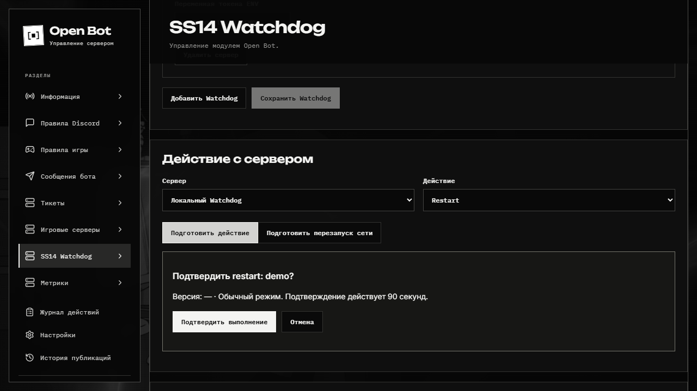

# SS14 Watchdog

Модуль управляет экземплярами SS14 через Watchdog HTTP API. Доступен администраторам Open Bot в веб-панели и через `/watchdog`. Все действия, влияющие на сервер, требуют отдельного подтверждения.

## Настройка

```dotenv
WATCHDOG_TOKEN_MAIN=секрет_из_Watchdog
```

После добавления секрета в ENV перезапустите службу. Разрешённые хосты задайте в **Настройки → Настройки приложения**. В **SS14 Watchdog** задайте ID сервера, название, базовый HTTP(S) URL, ID экземпляра и **имя** переменной `WATCHDOG_TOKEN_MAIN`. Сам секрет в форму не вводится и в SQLite не сохраняется. Допускаются дополнительные имена `WATCHDOG_TOKEN_*`; при Docker-развёртывании явно передайте их в `environment` Compose. По умолчанию Compose передаёт только `WATCHDOG_TOKEN_MAIN`.

Хост должен точно входить в разрешённый список настроек приложения; перенаправления и credentials в URL запрещены. Basic Auth использует ID экземпляра и соответствующий ENV-токен. Для доступа через публичную сеть используйте HTTPS.

## Действия

| Действие        | Поведение                                                                              |
| --------------- | -------------------------------------------------------------------------------------- |
| Restart         | Запрос перезапуска экземпляра.                                                         |
| Update          | Запрос обновления.                                                                     |
| Stop            | Остановка после завершения раунда согласно Watchdog.                                   |
| Revert          | Откат на версию из списка Watchdog; отдельно выбирается прерывание текущего раунда.    |
| Перезапуск сети | Подтверждённая группа перезапусков всех настроенных экземпляров, результат по каждому. |

Команды: `/watchdog list`, `add`, `remove`, `versions`, `action`, `restart-network`. Кнопка подтверждения привязана к инициатору, действует 90 секунд и используется один раз. Изменение конфигурации делает старое подтверждение недействительным.

## Неизвестный результат



HTTP 2xx означает, что Watchdog принял запрос, а не что игра уже запущена. Посмотрите состояние через Game Server Status или сам Watchdog.

При потере ответа, timeout или HTTP 5xx результат отмечается **unknown**. Повторный POST автоматически не отправляется. Новые действия с этим экземпляром блокируются, включая ранее подготовленные подтверждения. Администратор выясняет состояние экземпляра и явно снимает блокировку в истории операций. Прерывание процесса во время операции также требует ручной проверки.

Сетевой перезапуск не является атомарным: часть экземпляров может принять запрос, часть — нет. Повторное подтверждение не повторяет группу. Запросы ограничены по времени и выполняются максимум по пять одновременно.
